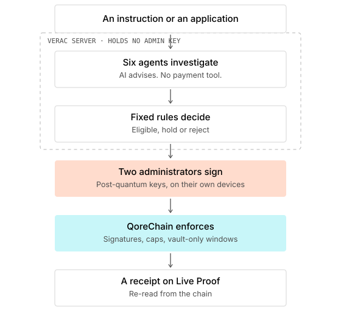

# Verac

Paying a contractor in a DAO takes more than sending money. Someone has to check the invoice, confirm the work was approved, verify the payout address, check the treasury and get the right people to sign off. Reviewing grant applications adds another layer of work: checking projects, budgets, milestones and claims before deciding who to fund.

I built **Verac** to help with that. Its AI agents investigate invoices and grant applications, flag problems and prepare payment requests. People make the funding decisions. On QoreChain, the contracts check the required approvals and enforce spending limits. The AI doesn't get to approve its own payments.

**[Try Verac — three short tours, no sign-in needed](https://verac-web.vercel.app/start)** · [Open the app](https://verac-web.vercel.app/dashboard) · [Live Proof](https://verac-web.vercel.app/proof) · [Demo recording guide](docs/DEMO_SCRIPT.md)

Built for **QoreChain's Build Before Q-Day** hackathon, in the **Post-Quantum AI Agents** category. Everything runs on **Diana testnet** (EVM chain ID `9800`) with test QOR, not real funds.

[](https://build.qorechain.io/p/verac)

<p align="center"></p>

## What Verac does

### 1. Reviews contractor invoices

In the AI Command Center, I can ask:

> Review our three outstanding contractor invoices, check whether their milestones were approved, flag anything suspicious, and prepare eligible payments.

Six agents work through the request:

| Agent | Its job |
|---|---|
| Invoice | Checks duplicates, vendor details, payout-address changes and instructions hidden in invoice text. |
| Milestone | Checks whether the work was approved, disputed or already paid. |
| Security | Looks for replay attempts, suspicious changes and prompt injection. |
| Treasury | Checks balance, approved recipients and spending limits. |
| Policy | Uses fixed rules—not an AI judgement—to mark a request **Eligible**, **Hold** or **Reject**. |
| Payment | Prepares the exact request if it passes the checks. It doesn't approve the payment. |

In a recorded Diana testnet run, Verac reviewed three invoices. One was eligible, one had an unapproved milestone, and one had a changed payout address plus a hidden instruction aimed at the AI. The last two were held. A different administrator approved the eligible request, and **1.25 QOR was paid on-chain through the original vault**.

Every run has a timeline and a decision receipt separating the agents' findings, policy decisions, human approvals and blockchain result. Workflows are saved and can resume after a refresh or worker restart without repeating a payment.

[Invoice workflow and transaction](docs/LIVE_WORKFLOW_2026-11-16.md) · [Architecture](docs/ARCHITECTURE.md#multi-agent-workflow)

### 2. Investigates grant applications

Verac helps a grant manager review applications before deciding where the money should go. The agents can:

- Check submitted GitHub repositories, websites and claimed deployments on Diana.
- Compare claims with available evidence and record what could not be verified.
- Score a published rubric using Gemini, with evidence or application text supporting each score.
- Apply fixed rules to budget and milestone checks.
- Flag similar applications, reused payout addresses, changed addresses and conflicting claims.
- Draft questions when an applicant needs to explain something.

A grant recommendation isn't an award. **One administrator recommends; a different administrator makes the award decision.** Funding still has to pass the treasury's approval process.

The demo uses fictional grant applicants. Its research checks use real external sources when available. In the sample run, Alpha was a strong candidate, Beta needed to explain its budget and milestones, and Gamma was flagged for further review because its claims did not match the available evidence.

I also tested the grant agents against **17 prompt-injection cases** and sent attacks to the real Gemini model. In those recorded tests, no score was inflated and the suspicious inputs were flagged for review.

[Grant investigation](docs/GRANTS.md) · [Grant security tests](docs/GRANTS_AUDIT.md)

### 3. Keeps payment approval with people

The original TreasuryVault used a server-held approver key. That meant a compromised server could potentially approve and pay within the vault's limits. **TreasuryVault V2 was built to remove that weakness from the V2 payment path.**

V2 has no owner who can move funds alone:

- Each payment and sensitive administrative change needs **two of three administrators' ML-DSA-87 signatures**.
- QoreChain verifies those signatures on-chain through its post-quantum signature-checking feature.
- Administrators sign requests separately using `pnpm v2:admin sign`. The website server holds **no V2 administrator signing key**.
- The payment agent still has recipient, per-payment and daily limits.
- A guardian can pause the vault or revoke an agent, but cannot transfer funds.
- Administrator keys can be replaced through the same threshold-approval process. I tested a replacement on-chain on 20 November.

V2 is connected to the website. In its live test, two legitimate payments were executed, taking the vault from **5 QOR to 3.7 QOR**.

[Complete V2 run and receipts](docs/V2_LIVE_2026-11-19.md) · [Security model](docs/SECURITY.md)

## Security tests and blockchain proof

I tested V2 using the credentials available to Verac's server. All **13 unauthorised operations were refused**. The tests covered missing or forged administrator signatures, replayed approvals, changed amounts, unapproved recipients, payments above caps, unauthorised policy changes, and expired or revoked agents.

Most refusals came from the contract. One direct-transfer attempt was rejected by **QoreChain before the transaction was included**. The proof documents distinguish these results rather than calling every failure a contract revert.

On **18 November 2026**, Verac's Q-Day drill proof was accepted. The attacker bot had the drill account's classical key but took no funds.

**[View Live Proof](https://verac-web.vercel.app/proof)** — the page checks recorded chain evidence. The repository also has a `pnpm proof:check` command to recheck documented transaction hashes. The latest figures I reported were **101 of 101 proof checks** and approximately **575 automated tests**; the live CI and proof output are the source of truth as these totals change.

| Date | Recorded result | Details |
|---|---|---|
| 14 Nov 2026 | Escrow funded and a 60 QOR contractor milestone released using scripts; refused operations recorded | [Run](docs/LIVE_RUN_2026-11-14.md) |
| 15 Nov | First website payment: one user requested 1 QOR, another approved, and V1 paid | [Payment](docs/LIVE_PAYMENT_2026-11-15.md) |
| 16 Nov | Six agents reviewed three invoices; one paid 1.25 QOR through V1 and two were held | [Workflow](docs/LIVE_WORKFLOW_2026-11-16.md) |
| 17 Nov | EVM authorisation windows and native spending restrictions tested | [Category evidence](docs/CATEGORY_COMPLIANCE.md) |
| 18 Nov | Q-Day drill proof accepted; attacker did not take funds | [Drill](docs/QDAY_DRILL.md) |
| 19 Nov | V2 payment and 13 security refusals; grant investigation using GitHub, Diana and Gemini | [V2](docs/V2_LIVE_2026-11-19.md) · [Grants](docs/GRANTS.md) |
| 20 Nov | V2 enabled in the website; administrator key replacement tested on-chain | [V2 record](docs/V2_LIVE_2026-11-19.md#administrator-key-replaced-2026-11-20) |

## Why QoreChain matters

Verac uses QoreChain because holding a private key shouldn't automatically give an agent permission to spend.

**Authorisation windows.** An EVM agent needs a window opened by an authorised native transaction. Those windows can restrict the allowed contract, amount, number of transactions and expiry. Verac's payment-agent window is restricted to the vault. The native account's hybrid-signature requirements are important to the Q-Day threat model.

**Post-quantum approvals.** TreasuryVault V2 verifies administrators' ML-DSA-87 signatures inside the contract. An ordinary server key cannot replace two valid administrator approvals.

**Encrypted documents.** QoreSeal encrypts supported bids, milestone evidence and documents in the browser using ML-KEM-1024 and X25519; the server stores encrypted copies.

This is a defined security design, **not a claim that the entire application is quantum-proof**. The V2 administrator keys are separate from the website server but, for this demo, are still files on one computer.

[Threat model](docs/THREAT_MODEL.md) · [QoreChain category evidence](docs/CATEGORY_COMPLIANCE.md)

## Contracts

| Contract | Purpose |
|---|---|
| `TreasuryVaultV2` | Two-of-three post-quantum approvals, spending caps, approved recipients and emergency controls |
| `TreasuryVault` (V1) | Original restricted vault with exact-payment approvals |
| `MilestoneEscrow` | Milestones, reviewer approvals, disputes and refunds for grants and procurement |
| `PolicyManager` | Policy versions and revocations |
| `OrganizationRegistry` | Organisation and role references |
| `AuditAnchor` | On-chain commitments to evidence |

Payment approvals are tied to the chain, vault, agent, token, recipient, amount, purpose, policy version, nonce and expiry. Changing any of these invalidates the approval.

[Deployed addresses](deployments/) · [Contract evidence](docs/V2_LIVE_2026-11-19.md)

## What's in the app

The main workflow uses **AI Command Center, Bills & Invoices, Treasury, Approvals, Grants, Milestones, Policies and Live Proof**. The dashboard and Quantum Simulator help explain the system and its security.

Other areas—including payroll, revenue, procurement, governance, disputes, DCA, arbitrage, documents and threat tools—are grouped under **Labs** where appropriate. Those pages distinguish working functionality from simulations and features without live transaction proof. I haven't treated a working screen as proof of an executed payment.

The app is built with **Next.js, TypeScript, Supabase, Gemini, viem and the QoreChain SDK**. It has 19 agents with tool permissions enforced in code; only the Payment Agent can submit a payment, and only after the required checks. Agent messages are HMAC-authenticated and protected against replay. Database access uses row-level security.

## Tests and running locally

Automated tests cover agent behaviour, invoice and grant reviews, payment rules and database permissions. Database tests replay the migrations in an in-memory Postgres instance. Foundry runs contract unit, fuzz and invariant tests. CI also checks type safety and application behaviour.

Requirements: **Node.js 22**, **pnpm 10**, and [Foundry](https://getfoundry.sh) for Solidity tests.

```bash
pnpm install
pnpm test
pnpm typecheck
pnpm proof:check
```

For contracts:

```bash
cd contracts && pnpm install --ignore-workspace && forge test
```

The site can run in read-only mode without live credentials. Sign-in, agent services and testnet execution require the documented setup. Live payments are disabled unless `LIVE_EXECUTION_ENABLED=true`.

[Deployment guide](docs/DEPLOYMENT.md) · [Supabase setup](docs/SUPABASE_SETUP.md) · [Operations runbook](docs/RUNBOOK.md)

## What isn't finished

Verac is a **testnet prototype**, not a production custody service. It has **not had an external security audit**.

- V1 still uses server-held agent and approver keys, with a 10 QOR per-payment cap and 20 QOR daily cap. V2 uses independent administrator signatures, but its agent still has a restricted server-held key.
- The three V2 administrator keys are currently files on one demo computer, not keys managed independently by a real DAO or in hardware devices.
- Large grant milestone payments still need an authorised on-chain funding route.
- The QoreX extension does not currently support the contract-signing flow used here; Verac uses restricted testnet keys for those calls.
- Agent messages use HMAC rather than post-quantum signatures, and database administrators could alter the database activity log.
- The grant examples use fictional applicants and synthetic data. Free-tier Gemini inputs may be used by Google.

Those are limits of the current build, not features I'm claiming are solved.

## Licence and credits

[MIT licensed](LICENSE). Built with Next.js, Supabase, Google Gemini, QoreChain SDK and QoreSeal, viem, OpenZeppelin Contracts, Foundry, Zod and PGlite. [AI_USAGE.md](AI_USAGE.md) explains how AI was used in building and running Verac.
