# State machines

<!-- Generated from packages/shared-types/src/state-machines.ts by `pnpm state:docs`. Do not edit by hand. -->

Every status or state column in Verac, as one explicit machine. The database allows exactly these states (tested by
replaying every migration), the code writes only declared moves (tested by scanning every write), and the same labels
and colours appear on every page. Agents and tools can read the same rules as JSON from `/api/state-machines`.

Legend: **terminal** = nothing leaves it; **steady** = rows normally rest there; **reserved** = allowed by the database but
never written by any code today.

| Machine | Table | States | Moves |
|---|---|---|---|
| [Payment request](#payment) | `transactions.state` | 11 | 18 |
| [Payroll batch](#payroll) | `payroll_batches.status` | 5 | 3 |
| [Invoice](#invoice) | `invoices.status` | 5 | 3 |
| [Money owed to the organisation](#revenue) | `revenue_records.status` | 4 | 3 |
| [Grant round](#grant-round) | `grants.status` | 3 | 2 |
| [Grant application](#grant-application) | `grant_applications.status` | 7 | 9 |
| [Clarification request](#grant-clarification) | `grant_clarifications.status` | 4 | 4 |
| [Risk flag](#grant-risk-flag) | `grant_risk_flags.status` | 3 | 3 |
| [Grant milestone funding](#grant-funding) | `grant_funding_records.status` | 5 | 5 |
| [Evidence check](#grant-evidence) | `grant_evidence.status` | 5 | 5 |
| [Milestone](#milestone) | `milestones.status` | 5 | 10 |
| [Tender](#tender) | `procurements.status` | 5 | 5 |
| [Dispute](#dispute) | `disputes.status` | 3 | 2 |
| [Governance proposal](#proposal) | `governance_proposals.status` | 5 | 4 |
| [Agent workflow](#workflow) | `agent_tasks.state` | 7 | 8 |
| [Saved strategy](#strategy) | `strategies.status` | 3 | 2 |
| [Membership](#membership) | `memberships.status` | 3 | 1 |
| [Organisation](#organization) | `organizations.status` | 2 | 1 |
| [Agent registration](#agent) | `agents.status` | 3 | 1 |
| [Spending policy](#policy) | `policies.status` | 5 | 1 |

## payment

**Payment request** · `transactions.state` · lifecycle

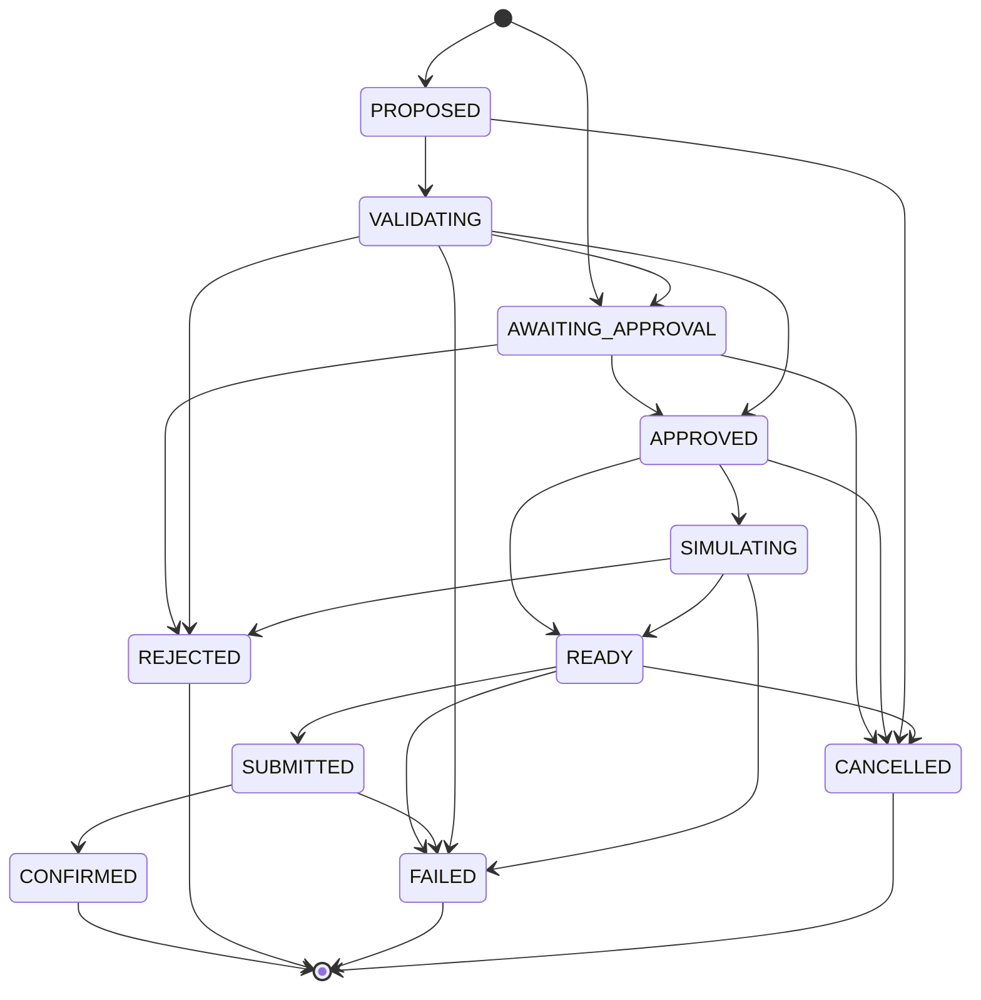

| State | Label | Meaning | Notes |
|---|---|---|---|
| `PROPOSED` | Proposed | An agent drafted the payment inside the agent pipeline; nothing is recorded for approval yet. |  |
| `VALIDATING` | Checking | Fixed rules are checking the amount, recipient and limits (agent pipeline). |  |
| `AWAITING_APPROVAL` | Awaiting approval | Waiting for a different person to approve exactly this payment (or two administrators to sign it on V2). |  |
| `APPROVED` | Approved | Approved for exactly this amount and recipient; not sent yet. |  |
| `SIMULATING` | Simulating | The call is being simulated against the chain before sending (agent pipeline). |  |
| `READY` | Sending | Claimed for execution; the transaction is being sent. |  |
| `SUBMITTED` | Sent | Sent to the chain; waiting for the receipt. |  |
| `CONFIRMED` | Confirmed on chain | The chain confirmed the payment and its event matched the approved payment hash. | terminal |
| `REJECTED` | Rejected | A person or a rule refused it. Nothing moved. | terminal |
| `FAILED` | Failed | Sending or confirming failed; nothing moved. A retry is a new request. | terminal |
| `CANCELLED` | Cancelled | Withdrawn or expired before it was sent. Nothing moved. | terminal |

| From | To | Via | Who |
|---|---|---|---|
| (new) | `AWAITING_APPROVAL` | request_payment / live_propose_payment / v2 propose | finance role, or the Payment agent on its behalf |
| `AWAITING_APPROVAL` | `APPROVED` | decide_payment (enough approvals) / set_admin_signer (enough V2 signatures) | a different administrator; on V2, two administrators' ML-DSA-87 signatures |
| `AWAITING_APPROVAL` | `REJECTED` | decide_payment | an approver |
| `AWAITING_APPROVAL`, `APPROVED` | `CANCELLED` | decide_payment / live_claim_execution (expired) | the system, when the approval window has passed |
| `APPROVED` | `READY` | live_claim_execution | an administrator pressing Execute |
| `READY` | `SUBMITTED` | live_record_submitted | the server, after the chain accepts the transaction |
| `READY`, `SUBMITTED` | `FAILED` | live_record_failure / live_record_receipt | the server, when sending or the receipt fails |
| `SUBMITTED` | `CONFIRMED` | live_record_receipt | the server, after verifying the receipt and the vault event |
| (new) | `PROPOSED` | agent pipeline | an agent |
| `PROPOSED` | `VALIDATING` | agent pipeline | an agent |
| `PROPOSED` | `CANCELLED` | agent pipeline | an agent |
| `VALIDATING` | `AWAITING_APPROVAL` | agent pipeline | fixed rules |
| `VALIDATING` | `APPROVED` | agent pipeline (within an auto-approve cap) | fixed rules |
| `VALIDATING`, `SIMULATING` | `REJECTED` | agent pipeline | fixed rules |
| `VALIDATING`, `SIMULATING` | `FAILED` | agent pipeline | fixed rules |
| `APPROVED` | `SIMULATING` | agent pipeline | an agent |
| `SIMULATING` | `READY` | agent pipeline | an agent |
| `READY` | `CANCELLED` | agent pipeline | an agent |

## payroll

**Payroll batch** · `payroll_batches.status` · lifecycle

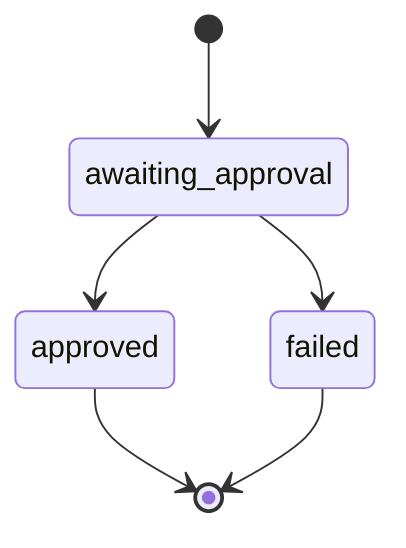

| State | Label | Meaning | Notes |
|---|---|---|---|
| `draft` | Draft | Being prepared. | reserved: submit_payroll_batch creates batches directly as awaiting approval. |
| `awaiting_approval` | Awaiting approval | Submitted with its payment request; waiting for a different finance member. |  |
| `approved` | Approved, not paid | Its payment request was approved in Verac; payroll does not send QOR yet (Labs). | terminal |
| `paid` | Paid | Paid on chain. | reserved: Approved payroll batches do not send QOR yet (Labs). |
| `failed` | Failed | Its payment request was rejected or expired. | terminal |

| From | To | Via | Who |
|---|---|---|---|
| (new) | `awaiting_approval` | submit_payroll_batch | finance role |
| `awaiting_approval` | `approved` | decide_payment | a different finance member |
| `awaiting_approval` | `failed` | decide_payment | an approver, or expiry |

## invoice

**Invoice** · `invoices.status` · lifecycle

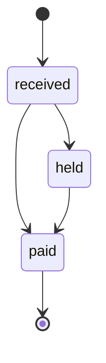

| State | Label | Meaning | Notes |
|---|---|---|---|
| `received` | Received | Recorded exactly as the contractor sent it; not reviewed yet. |  |
| `held` | On hold | Its payment failed or was refused; a person must look again. |  |
| `approved` | Approved | Approved for payment. | reserved: The agent workflow records its decision on the payment request, not on the invoice. |
| `paid` | Paid | Its payment was confirmed on chain. | terminal |
| `rejected` | Rejected | Will not be paid. | reserved: Rejections are recorded on the workflow, not on the invoice. |

| From | To | Via | Who |
|---|---|---|---|
| (new) | `received` | record_invoice / load demo | finance role |
| `received`, `held` | `paid` | invoice_follow_payment (trigger) | the system, when the linked payment is confirmed |
| `received` | `held` | invoice_follow_payment (trigger) | the system, when the linked payment fails or is rejected |

## revenue

**Money owed to the organisation** · `revenue_records.status` · lifecycle

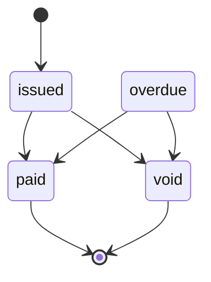

| State | Label | Meaning | Notes |
|---|---|---|---|
| `issued` | Outstanding | Owed and not yet paid. |  |
| `overdue` | Overdue | Past its due date. | reserved: Overdue is worked out from the due date when the page is shown; it is never stored. |
| `paid` | Paid | Marked paid; verified on chain when a transaction hash was given. | terminal |
| `void` | Void | Cancelled with a recorded reason. | terminal |

| From | To | Via | Who |
|---|---|---|---|
| (new) | `issued` | record_revenue | finance role |
| `issued`, `overdue` | `paid` | mark_revenue_paid | finance role |
| `issued`, `overdue` | `void` | void_revenue_record | finance role |

## grant-round

**Grant round** · `grants.status` · lifecycle

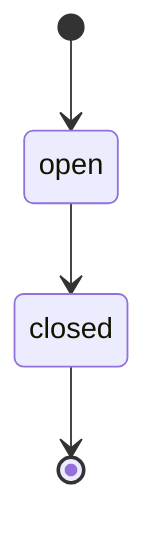

| State | Label | Meaning | Notes |
|---|---|---|---|
| `draft` | Draft | Not published. | reserved: Rounds are created open. |
| `open` | Open | Accepting applications until its deadline. |  |
| `closed` | Closed | No new applications; existing ones continue. | terminal |

| From | To | Via | Who |
|---|---|---|---|
| (new) | `open` | create_grant_round | owner or administrator |
| `open` | `closed` | close_grant | owner or administrator |

## grant-application

**Grant application** · `grant_applications.status` · lifecycle

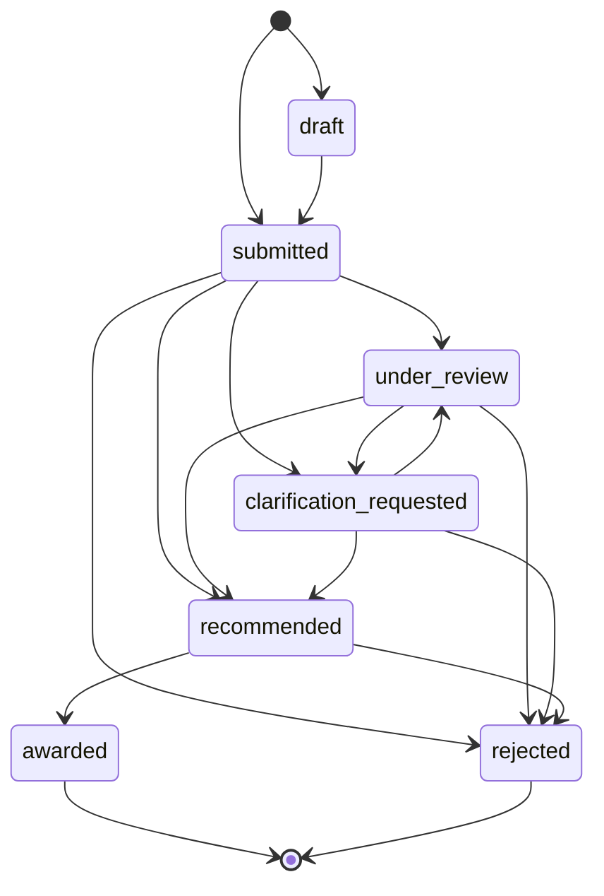

| State | Label | Meaning | Notes |
|---|---|---|---|
| `draft` | Draft | Private to the applicant; reviewers cannot see it. |  |
| `submitted` | Submitted | Submitted and locked as a version; waiting for review. |  |
| `under_review` | Under review | Agents or reviewers are investigating it. |  |
| `clarification_requested` | Clarification requested | Reviewers asked questions; the applicant may amend once. |  |
| `recommended` | Recommended | One administrator recommended it; a different administrator must award it. |  |
| `awarded` | Awarded | Awarded within the round budget; milestones decide when money moves. | terminal |
| `rejected` | Rejected | Not funded; the reason is recorded. | terminal |

| From | To | Via | Who |
|---|---|---|---|
| (new) | `draft` | save_grant_application | the applicant |
| (new) | `submitted` | apply_to_grant (one-step) / sample programme | the applicant, or an administrator loading the sample |
| `draft` | `submitted` | submit_grant_application | the applicant |
| `submitted` | `under_review` | grants engine / save_application_review | the investigation agents |
| `clarification_requested` | `under_review` | submit_grant_application (amendment) | the applicant |
| `submitted`, `under_review` | `clarification_requested` | send_grant_clarification | owner or administrator |
| `submitted`, `under_review`, `clarification_requested` | `recommended` | decide_application | owner or administrator |
| `submitted`, `under_review`, `clarification_requested`, `recommended` | `rejected` | decide_application | owner or administrator |
| `recommended` | `awarded` | award_application | a different owner or administrator |

## grant-clarification

**Clarification request** · `grant_clarifications.status` · lifecycle

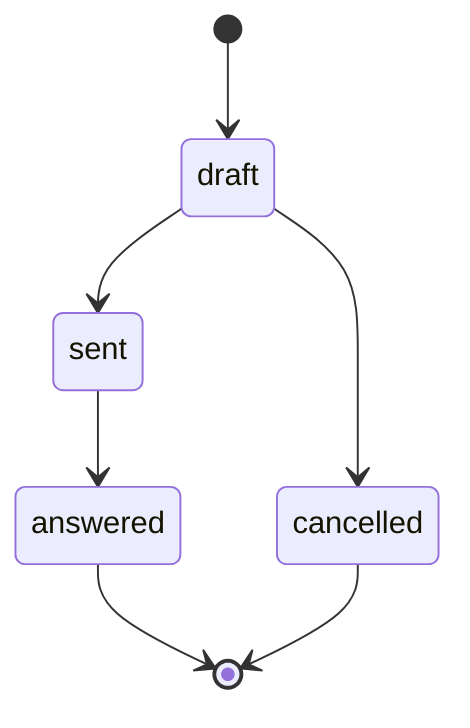

| State | Label | Meaning | Notes |
|---|---|---|---|
| `draft` | Draft | Drafted by the agents; not sent. |  |
| `sent` | Sent | Sent to the applicant; waiting for an answer. |  |
| `answered` | Answered | The applicant answered. | terminal |
| `cancelled` | Cancelled | Withdrawn before sending. | terminal |

| From | To | Via | Who |
|---|---|---|---|
| (new) | `draft` | grants engine | the investigation agents |
| `draft` | `sent` | send_grant_clarification | owner or administrator |
| `draft` | `cancelled` | cancel_grant_clarification | owner or administrator |
| `sent` | `answered` | answer_grant_clarification | the applicant |

## grant-risk-flag

**Risk flag** · `grant_risk_flags.status` · lifecycle

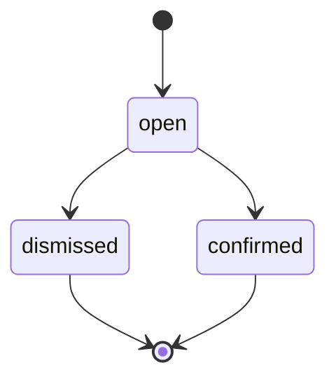

| State | Label | Meaning | Notes |
|---|---|---|---|
| `open` | Open | Raised by the agents; a person must decide. |  |
| `dismissed` | Dismissed | A person judged it not a problem, with a reason. | terminal |
| `confirmed` | Confirmed | A person confirmed the risk, with a reason. | terminal |

| From | To | Via | Who |
|---|---|---|---|
| (new) | `open` | grants engine | the risk agent |
| `open` | `dismissed` | decide_risk_flag | owner, administrator or security reviewer |
| `open` | `confirmed` | decide_risk_flag | owner, administrator or security reviewer |

## grant-funding

**Grant milestone funding** · `grant_funding_records.status` · lifecycle

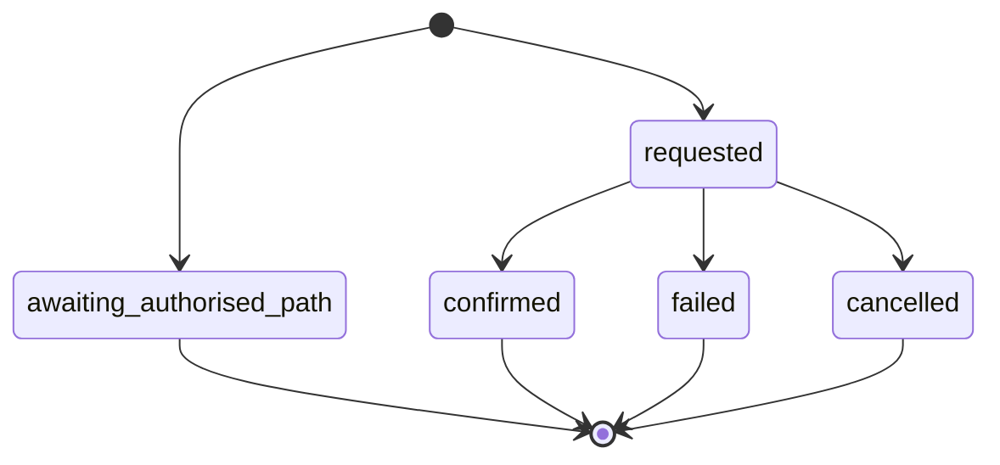

| State | Label | Meaning | Notes |
|---|---|---|---|
| `awaiting_authorised_path` | Awaiting a funding path | Approved, but no vault can pay this amount within its limits yet. | terminal |
| `requested` | Requested | A payment request exists in Approvals. |  |
| `confirmed` | Paid | The payment was confirmed on chain and the milestone released. | terminal |
| `failed` | Failed | The payment failed; nothing moved. | terminal |
| `cancelled` | Cancelled | The payment was rejected or expired; nothing moved. | terminal |

| From | To | Via | Who |
|---|---|---|---|
| (new) | `requested` | request_grant_milestone_payment | finance role |
| (new) | `awaiting_authorised_path` | request_grant_milestone_payment | finance role, when no vault can pay it |
| `requested` | `confirmed` | grant_follow_payment (trigger) | the system, on chain confirmation |
| `requested` | `failed` | grant_follow_payment (trigger) | the system |
| `requested` | `cancelled` | grant_follow_payment (trigger) | the system |

## grant-evidence

**Evidence check** · `grant_evidence.status` · classification

| State | Label | Meaning | Notes |
|---|---|---|---|
| `VERIFIED` | Verified | The source confirms the claim. | terminal |
| `PARTIALLY_VERIFIED` | Partly verified | The source confirms part of the claim. | terminal |
| `UNVERIFIED` | Unverified | Nothing was found that confirms or contradicts it. | terminal |
| `CONTRADICTED` | Contradicted | The source says otherwise. | terminal |
| `UNAVAILABLE` | Unavailable | The source could not be read (private, missing or rate limited). Not a negative finding. | terminal |

| From | To | Via | Who |
|---|---|---|---|
| (new) | `VERIFIED` | research agents | the research agent |
| (new) | `PARTIALLY_VERIFIED` | research agents | the research agent |
| (new) | `UNVERIFIED` | research agents | the research agent |
| (new) | `CONTRADICTED` | research agents | the research agent |
| (new) | `UNAVAILABLE` | research agents | the research agent |

## milestone

**Milestone** · `milestones.status` · lifecycle

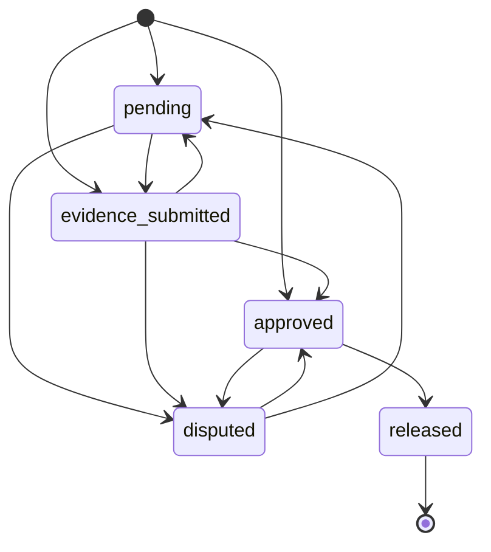

| State | Label | Meaning | Notes |
|---|---|---|---|
| `pending` | Waiting for evidence | Waiting for the vendor or grantee to submit evidence (in order). |  |
| `evidence_submitted` | Evidence submitted | Evidence is in; a reviewer must accept or reject it. |  |
| `approved` | Accepted | Evidence accepted; finance may request the payment. |  |
| `released` | Paid | The payment was confirmed on chain. | terminal |
| `disputed` | Disputed | Frozen until an administrator resolves the dispute. |  |

| From | To | Via | Who |
|---|---|---|---|
| (new) | `pending` | award_procurement / award_application | the award |
| (new) | `approved` | load demo | demo data only |
| (new) | `evidence_submitted` | load demo | demo data only |
| `pending` | `evidence_submitted` | submit_milestone_evidence / submit_grant_milestone_evidence | the vendor or grantee |
| `evidence_submitted` | `approved` | decide_milestone / decide_grant_milestone | a reviewer |
| `evidence_submitted` | `pending` | decide_milestone / decide_grant_milestone (rejected) | a reviewer |
| `pending`, `evidence_submitted`, `approved` | `disputed` | open_dispute | a party to the milestone |
| `disputed` | `approved` | resolve_dispute (accept work) | an administrator who did not open the dispute |
| `disputed` | `pending` | resolve_dispute (reject work) | an administrator who did not open the dispute |
| `approved` | `released` | grant_follow_payment (trigger) / escrow release | the system, on chain confirmation |

## tender

**Tender** · `procurements.status` · lifecycle

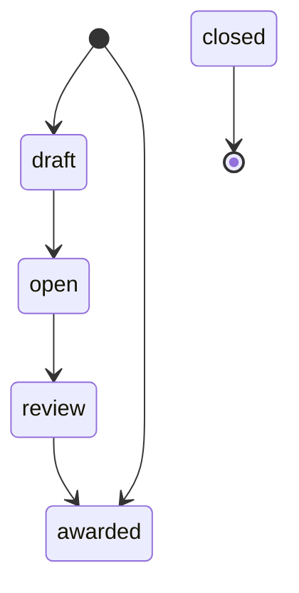

| State | Label | Meaning | Notes |
|---|---|---|---|
| `draft` | Draft | Not visible to vendors. |  |
| `open` | Open for bids | Vendors submit sealed bids until bidding closes. |  |
| `review` | Reviewing bids | Bids are opened by reviewers and checked by fixed rules. |  |
| `awarded` | Awarded | A person chose the winner; milestones were created. | steady: Work continues on its milestones; closing an awarded tender is not built yet. |
| `closed` | Closed | Finished. | terminal; reserved: No code closes an awarded tender yet. |

| From | To | Via | Who |
|---|---|---|---|
| (new) | `draft` | createTender | procurement role |
| (new) | `awarded` | load demo | demo data only |
| `draft` | `open` | open_tender | procurement role |
| `open` | `review` | close_bidding | procurement role |
| `review` | `awarded` | award_procurement | procurement role |

## dispute

**Dispute** · `disputes.status` · lifecycle

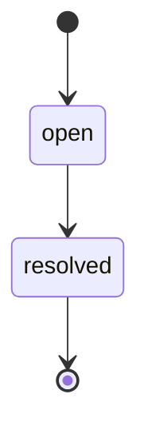

| State | Label | Meaning | Notes |
|---|---|---|---|
| `open` | Open | The milestone is frozen; statements are being collected. |  |
| `under_review` | Under review | Being reviewed. | reserved: Disputes go straight from open to resolved. |
| `resolved` | Resolved | Decided by an administrator who did not open it, with a reason. | terminal |

| From | To | Via | Who |
|---|---|---|---|
| (new) | `open` | open_dispute | a party to the milestone |
| `open` | `resolved` | resolve_dispute | an administrator who did not open it |

## proposal

**Governance proposal** · `governance_proposals.status` · lifecycle

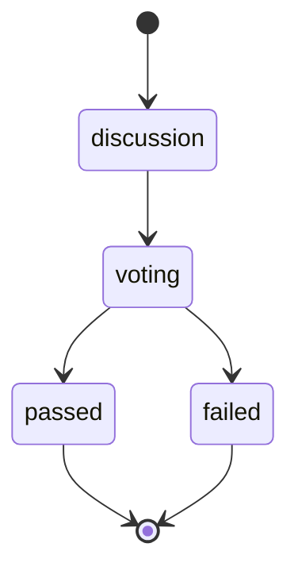

| State | Label | Meaning | Notes |
|---|---|---|---|
| `discussion` | Discussion | Being discussed; voting has not opened. |  |
| `voting` | Voting | Members vote until the deadline. |  |
| `passed` | Passed | Quorum met and the pass line reached. Executes nothing by itself. | terminal |
| `failed` | Failed | Quorum missed or the pass line not reached. | terminal |
| `executed` | Executed | Carried out. | reserved: Proposals execute nothing; spending goes through Approvals. |

| From | To | Via | Who |
|---|---|---|---|
| (new) | `discussion` | create_proposal | owner or administrator |
| `discussion` | `voting` | open_voting | owner or administrator |
| `voting` | `passed` | finalize_proposal | any member, after the deadline |
| `voting` | `failed` | finalize_proposal | any member, after the deadline |

## workflow

**Agent workflow** · `agent_tasks.state` · lifecycle

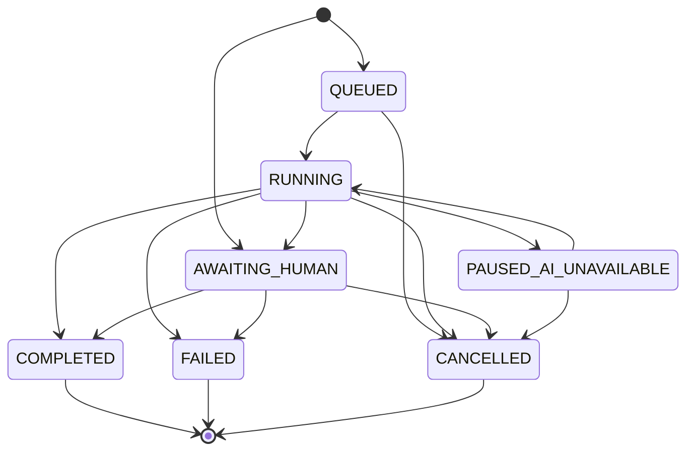

| State | Label | Meaning | Notes |
|---|---|---|---|
| `QUEUED` | Queued | Waiting for a worker to claim it. |  |
| `RUNNING` | Running | Agents are working through the steps; each step is saved. |  |
| `AWAITING_HUMAN` | Waiting for a person | Agents finished their part; a person must decide. |  |
| `PAUSED_AI_UNAVAILABLE` | Paused: AI unavailable | The AI quota or service is unavailable; it resumes when it returns. |  |
| `COMPLETED` | Completed | Finished; the receipt is available. | terminal |
| `FAILED` | Failed | Stopped with a recorded error. | terminal |
| `CANCELLED` | Cancelled | Cancelled by a person; anything it prepared was withdrawn. | terminal |

| From | To | Via | Who |
|---|---|---|---|
| (new) | `QUEUED` | start_invoice_workflow / start_grant_workflow | finance role or administrator |
| (new) | `AWAITING_HUMAN` | agent payment task | the Payment agent |
| `QUEUED`, `PAUSED_AI_UNAVAILABLE` | `RUNNING` | claim_workflow / claim_grant_workflow | a worker holding the lease |
| `RUNNING` | `AWAITING_HUMAN` | workflow engines | the coordinator |
| `RUNNING` | `PAUSED_AI_UNAVAILABLE` | workflow engines | the coordinator |
| `RUNNING`, `AWAITING_HUMAN` | `COMPLETED` | workflow engines / decide_payment | the coordinator, or a person's decision |
| `RUNNING`, `AWAITING_HUMAN` | `FAILED` | workflow engines / decide_payment | the coordinator, or a person's decision |
| `QUEUED`, `RUNNING`, `AWAITING_HUMAN`, `PAUSED_AI_UNAVAILABLE` | `CANCELLED` | cancel_invoice_workflow / cancel_grant_workflow | the person who started it, or an administrator |

## strategy

**Saved strategy** · `strategies.status` · lifecycle

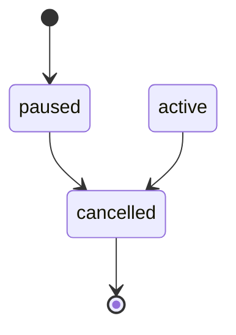

| State | Label | Meaning | Notes |
|---|---|---|---|
| `active` | Active | Would run on a schedule. | reserved: Strategies are simulations; nothing ever runs on a schedule. |
| `paused` | Paused | Saved numbers only; never runs. |  |
| `cancelled` | Cancelled | Removed from the list. | terminal |

| From | To | Via | Who |
|---|---|---|---|
| (new) | `paused` | save_strategy | finance role |
| `paused`, `active` | `cancelled` | cancel_strategy | finance role |

## membership

**Membership** · `memberships.status` · lifecycle

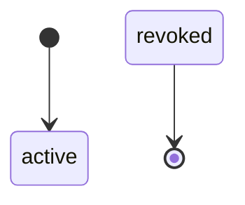

| State | Label | Meaning | Notes |
|---|---|---|---|
| `active` | Active | Can use the organisation within their role. | steady: Removing a member deletes the row. |
| `invited` | Invited | Invited, not joined. | reserved: Members are added directly by user id. |
| `revoked` | Revoked | No longer a member. | terminal; reserved: Removal deletes the membership today. |

| From | To | Via | Who |
|---|---|---|---|
| (new) | `active` | createOrganisation / add member / join demo | owner or administrator, or the visitor joining the read-only demo |

## organization

**Organisation** · `organizations.status` · lifecycle

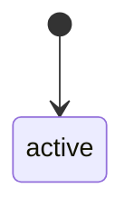

| State | Label | Meaning | Notes |
|---|---|---|---|
| `active` | Active | In use. | steady: Organisations are not suspended or closed in the app. |
| `suspended` | Suspended | Blocked. | reserved: No code suspends an organisation. |

| From | To | Via | Who |
|---|---|---|---|
| (new) | `active` | createOrganisation | any signed-in user |

## agent

**Agent registration** · `agents.status` · lifecycle

| State | Label | Meaning | Notes |
|---|---|---|---|
| `active` | Active | Registered and allowed its listed tools. | steady: Agents are stopped on chain (revoked spending rules), not by this record. |
| `suspended` | Suspended | Temporarily disabled. | reserved: Agents are switched off on chain (revoked spending rules), not here. |
| `revoked` | Revoked | Permanently disabled. | terminal; reserved: Agents are switched off on chain (revoked spending rules), not here. |

| From | To | Via | Who |
|---|---|---|---|
| (new) | `active` | agent registry seed | the system |

## policy

**Spending policy** · `policies.status` · lifecycle

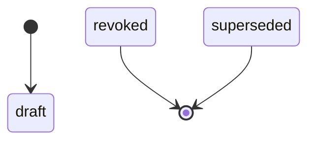

| State | Label | Meaning | Notes |
|---|---|---|---|
| `draft` | Draft | Being written. | steady: Policies are drafted and checked in the Policies tool; the vault holds the enforced limits. |
| `pending_approval` | Awaiting approval | Waiting for approval. | reserved: Policies are drafted and checked in the Policies tool; the vault holds the enforced limits. |
| `active` | Active | In force. | reserved: Policies are drafted and checked in the Policies tool; the vault holds the enforced limits. |
| `revoked` | Revoked | Withdrawn. | terminal; reserved: Policies are drafted and checked in the Policies tool; the vault holds the enforced limits. |
| `superseded` | Superseded | Replaced by a newer version. | terminal; reserved: Policies are drafted and checked in the Policies tool; the vault holds the enforced limits. |

| From | To | Via | Who |
|---|---|---|---|
| (new) | `draft` | policy records | owner or administrator |

